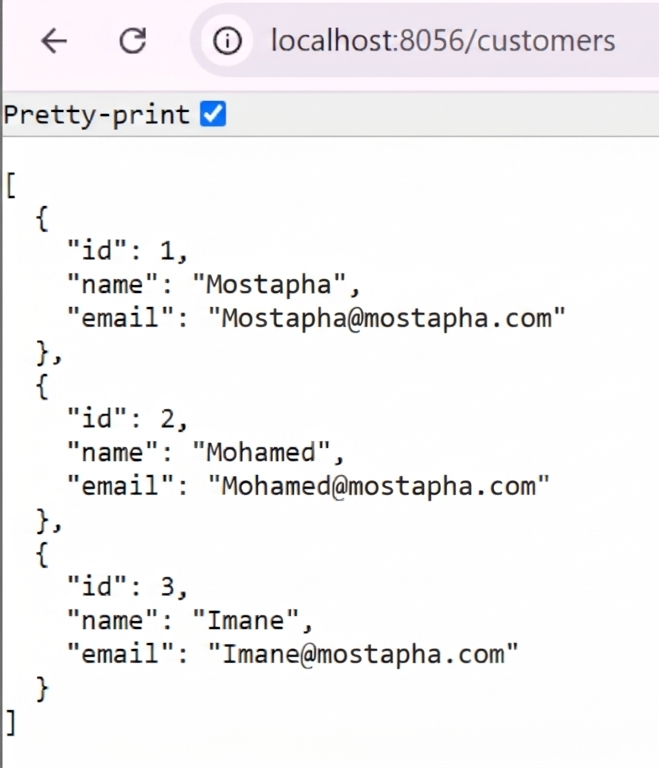
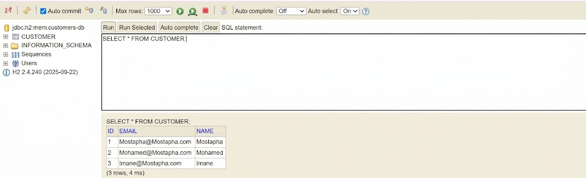
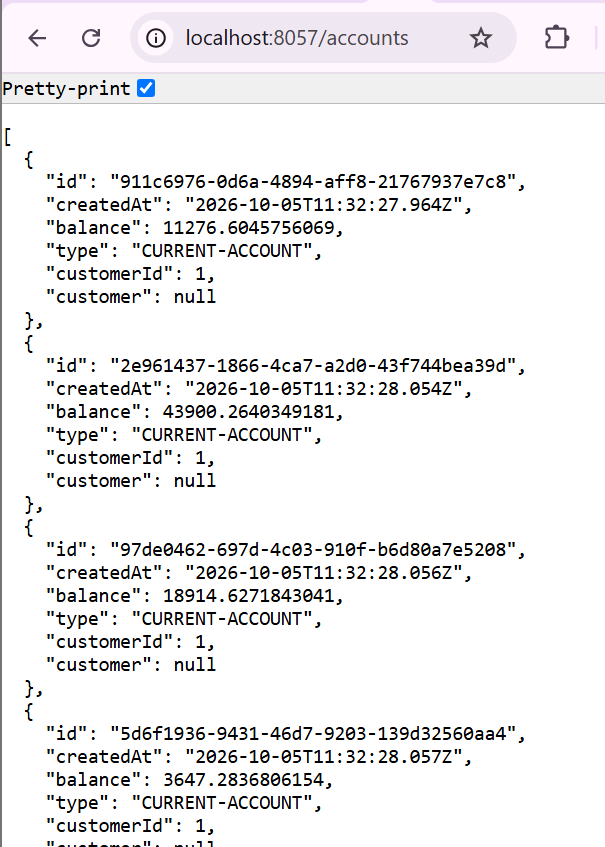
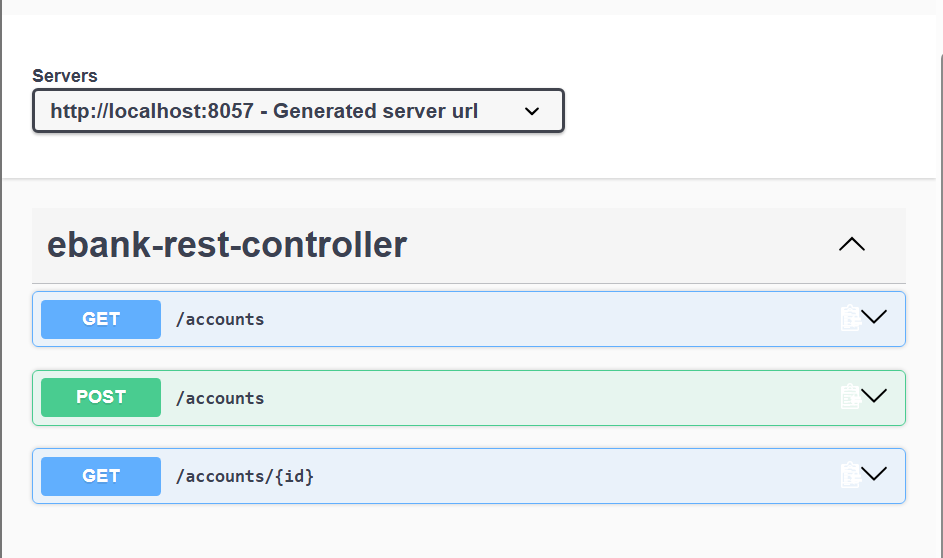
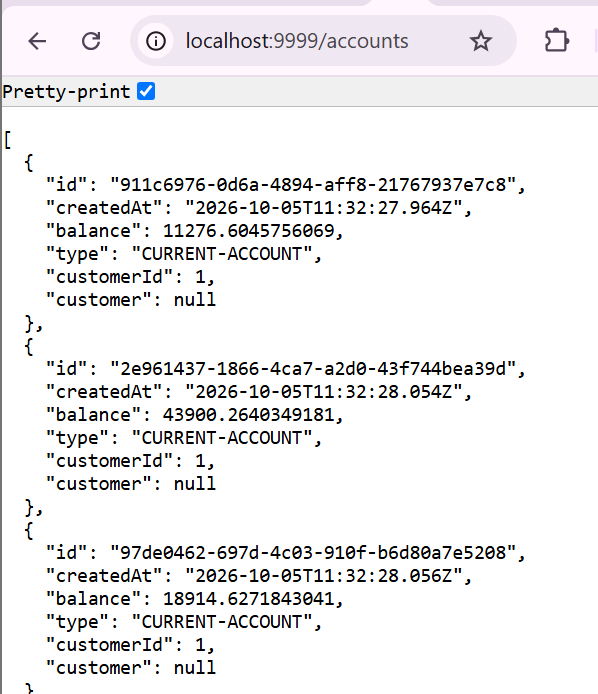
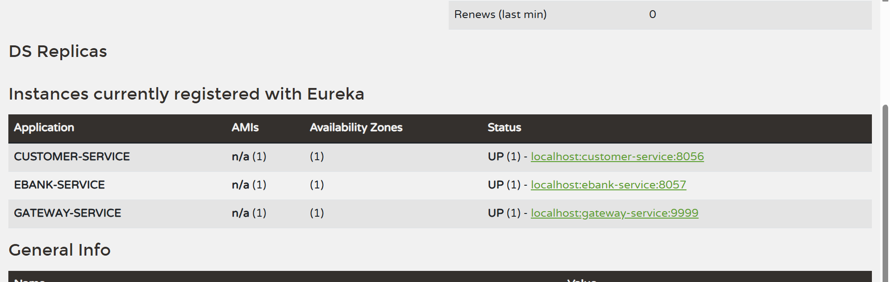
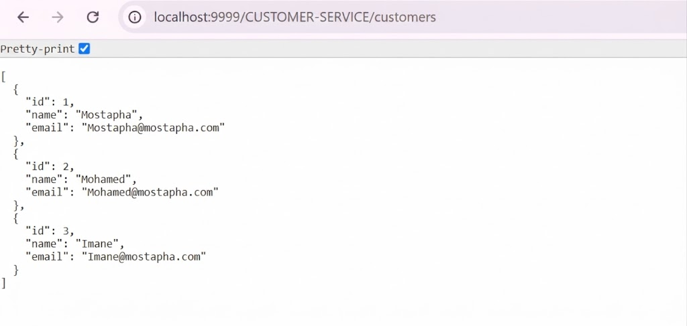
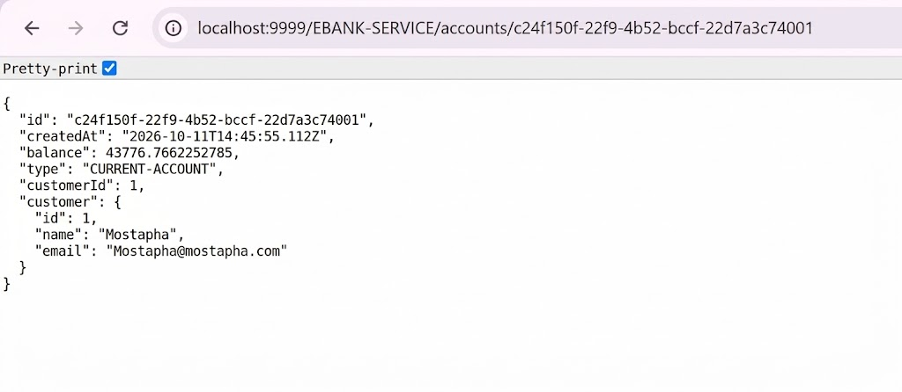
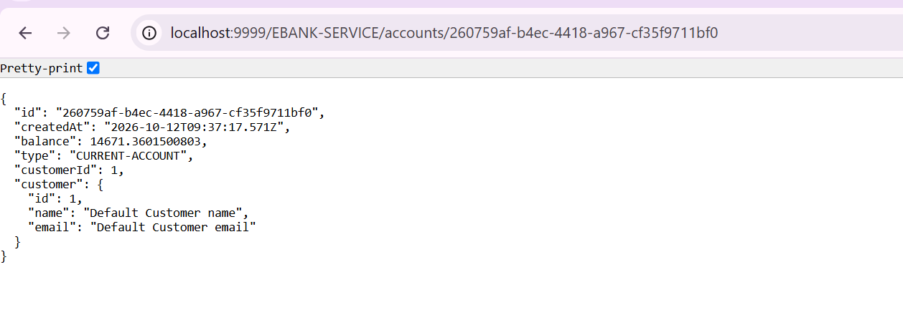

**Made by:** Bayi Mostapha, BDCC 3

---

# E-Bank Project, Part 1: Microservices Architecture

In this first part I built a microservices setup using **Spring Boot** and **Spring Cloud**. It has two business services, an API gateway, a service registry, service-to-service calls through OpenFeign, and fault tolerance with Resilience4J.

## Goals

- Build the **Customer-Service**
- Build the **EBank-Service**
- Connect both services using **OpenFeign**
- Add fault tolerance with a **Circuit Breaker (Resilience4J)**
- Build the **Gateway**
- Build the **Discovery Service** (Eureka)
- Test the backend with **Postman** and **Swagger UI**

## Tech stack

Java, Spring Boot, Spring Data JPA, Spring Cloud Gateway, Spring Cloud Netflix Eureka, Spring Cloud OpenFeign, Resilience4J, Swagger UI (OpenAPI), Postman, Maven.

## How the pieces fit together

```
                    ┌──────────────────┐
   REST client ───► │     Gateway      │
 (Postman/Swagger)  └────────┬─────────┘
                             │
              ┌──────────────┴───────────────┐
              ▼                              ▼
     ┌─────────────────┐   OpenFeign   ┌─────────────────┐
     │ Customer-Service│ ◄──────────── │  EBank-Service  │
     └────────┬────────┘               └────────┬────────┘
              └──────────┐      ┌───────────────┘
                         ▼      ▼
                  ┌───────────────────┐
                  │ Discovery Service │
                  │     (Eureka)      │
                  └───────────────────┘
```

## Running the project

Start order matters:

1. **Discovery Service** (Eureka)
2. **Customer-Service**
3. **EBank-Service** (wait until `CUSTOMER-SERVICE` shows up in the Eureka dashboard)
4. **Gateway**

> ⚠️ If EBank-Service starts before Customer-Service is registered in Eureka, you may get the error `Load balancer does not contain an instance for the service customer-service`.

---

## Implementation walkthrough

### 1. Customer-Service

This service handles customer data (full CRUD). It offers a REST API, for example `GET /customers/{id}`, and registers itself in Eureka as `customer-service`.

First API tests:






### 2. EBank-Service (Accounts-Service)

This service manages bank accounts. Every account belongs to a customer, whose details are fetched from Customer-Service. It registers as `ebank-service` and listens on port `8057`.

First API tests:






### 3. Gateway with static routing

The Gateway is the single entry point to the application. With **static routing**, each route is written by hand with the host and port of the target microservice.




### 4. Discovery Service (Eureka) and dynamic routing

The Discovery Service works as a directory of microservices: each one registers itself and can then be found by its name (`spring.application.name`). With **dynamic routing**, the Gateway no longer needs fixed addresses, because it looks them up in Eureka.





### 5. Calling services with OpenFeign

EBank-Service calls Customer-Service declaratively through a Feign client, and the service name is resolved by Eureka:

```java
@FeignClient(name = "customer-service")
public interface CustomerRestClient {
    @GetMapping("/customers/{id}")
    Customer getCustomersById(@PathVariable Long id);
}
```

Outcome: the customer details are fetched correctly and included in EBank-Service's response.



### 6. Fault tolerance with a Circuit Breaker (Resilience4J)

When Customer-Service is down, the Circuit Breaker stops the error from spreading and runs a *fallback* method that returns a default customer:

```java
@CircuitBreaker(name = "customerService", fallbackMethod = "getDefaultCustomer")
public Customer fetchCustomer(Long id) {
    return customerRestClient.getCustomersById(id);
}

public Customer getDefaultCustomer(Long id, Exception e) {
    return new Customer(id, "Default Customer name", "Default Customer email");
}
```

Test with Customer-Service stopped: the default customer is returned.

