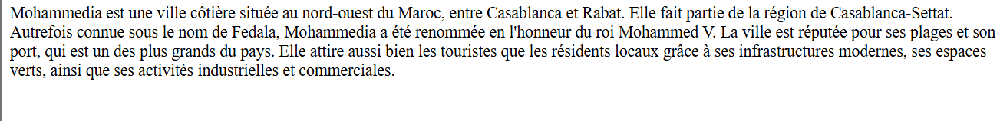
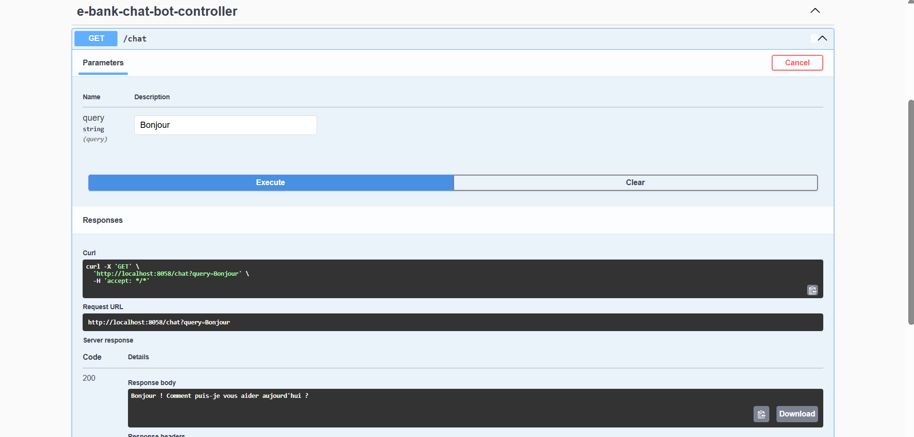
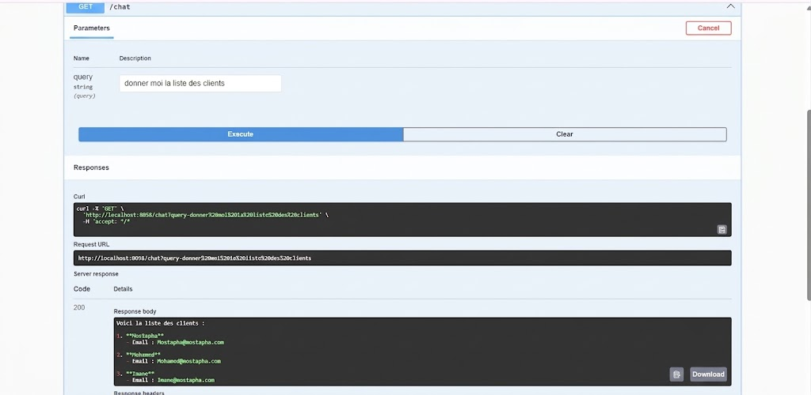
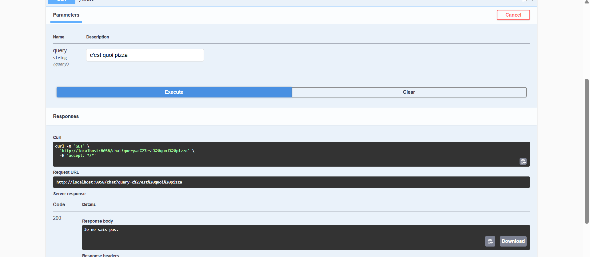
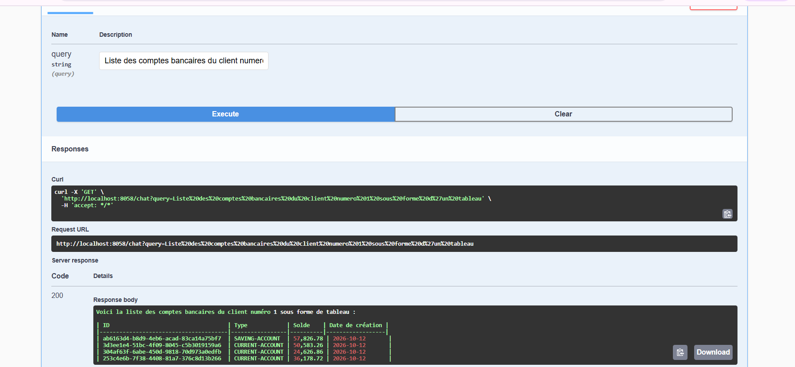
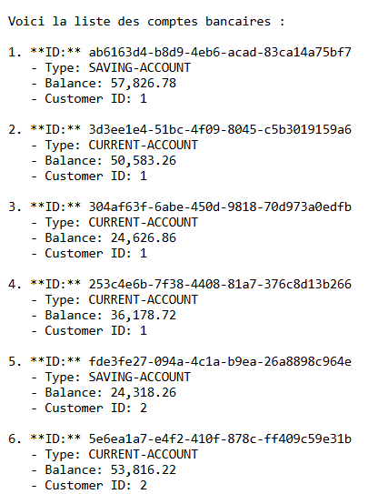
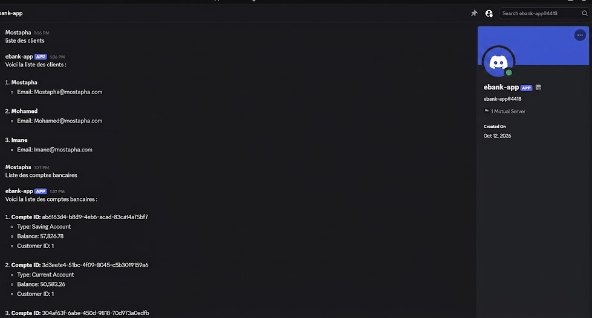
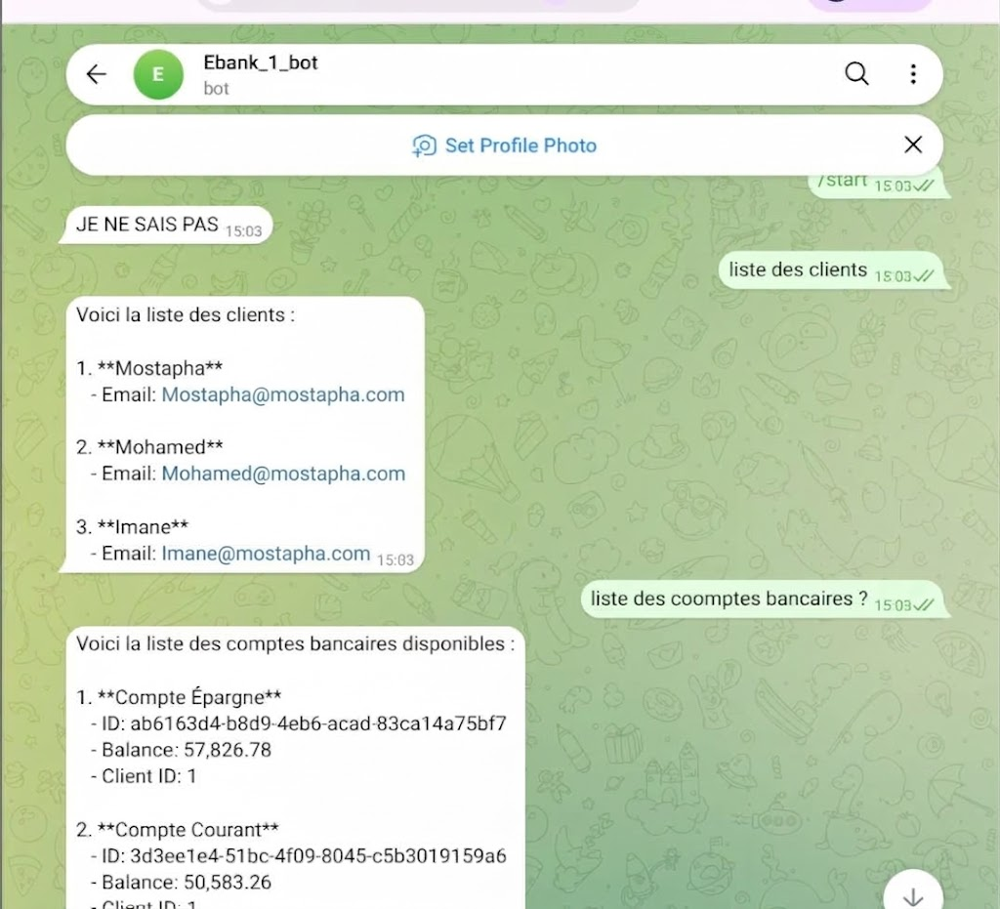

**Made by:** M'Bayi Mostapha, BDCC 3

---

# E-Bank Project, Part 2: AI Agent

This second part adds an **AI agent (chatbot)** on top of the microservices architecture from part 1. The agent is built with **Spring AI** and talks to **Customer-Service** and **EBank-Service** through the **Model Context Protocol (MCP)**. It is then tried out from a REST client, Discord and Telegram.

## Goals

- Build the **AI Agent** with **Spring AI**
- Expose the microservices' features through **MCP**
- Test the microservices with an **MCP Client**
- Connect the chatbot to the microservices over MCP
- Test the chatbot from a **REST client**
- Test the chatbot from a **Telegram client**
- Test the chatbot from a **Discord client**

## Tech stack

Java, Spring Boot, Spring AI, MCP (Model Context Protocol), Spring Cloud Gateway, Eureka, OpenFeign, Swagger UI (OpenAPI), Telegram, Discord, Maven.

## How the pieces fit together

```
  Discord / Telegram / REST client
                │
                ▼
        ┌───────────────┐
        │   AI Agent    │  (Spring AI + memory + system prompt)
        │   (Chatbot)   │
        └───────┬───────┘
                │ MCP
      ┌─────────┴──────────┐
      ▼                    ▼
┌──────────────┐   ┌──────────────┐
│ Customer-    │   │  EBank-      │
│ Service      │   │  Service     │
│ (MCP Server) │   │ (MCP Server) │
└──────────────┘   └──────────────┘
```

## Running the project

Recommended start order:

1. **Discovery Service** (Eureka)
2. **Customer-Service** and **EBank-Service** (each with its MCP server)
3. **Gateway**
4. **AI Agent** (chatbot)

---

## Implementation walkthrough

### 1. Building the AI Agent with Spring AI

The agent is a Spring Boot service that uses **Spring AI** to talk to a language model (OpenAI) and makes the chatbot available through a REST API.

**First test**

First conversation with the agent: the model answers the user's questions correctly.



**Testing from Swagger UI**

The chatbot endpoint is also tried out from Swagger UI.



**Chat memory**

To let the agent remember the conversation, a **chat memory** was added. It can now answer questions that refer back to earlier messages.


### 2. Exposing the microservices through MCP

The **Model Context Protocol (MCP)** is a standard that lets an LLM use external tools. The features of **Customer-Service** and **EBank-Service** are published as MCP *tools* so the agent can call them. They can first be checked with an MCP Client before being wired to the chatbot.

### 3. Connecting the chatbot to Customer-Service over MCP

The AI agent is set up as an **MCP client** of Customer-Service. It can now look up customer information from plain natural-language questions.



**System prompt**

A **system prompt** sets the agent's role and behavior, and explains how it should use the tools available to it.



### 4. Connecting the chatbot to EBank-Service over MCP

Next, the agent is connected to EBank-Service, so it can manage bank accounts.


**Finding an account by id**



**Creating an account (save)**


### 5. Testing through the Gateway

Requests now go through the **Gateway** from part 1, which forwards them to the microservices using the Discovery Service.



### 6. Chatting from Discord

The chatbot is linked to a **Discord** bot, so you can talk to the agent straight from a Discord server.



### 7. Chatting from Telegram

The chatbot is also linked to a **Telegram** bot.

